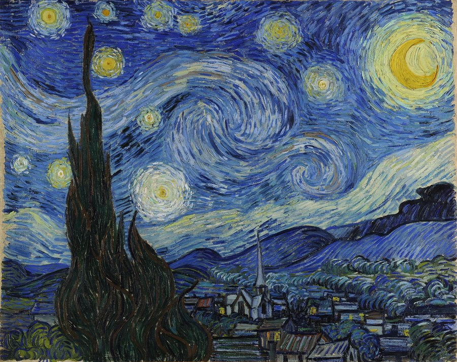
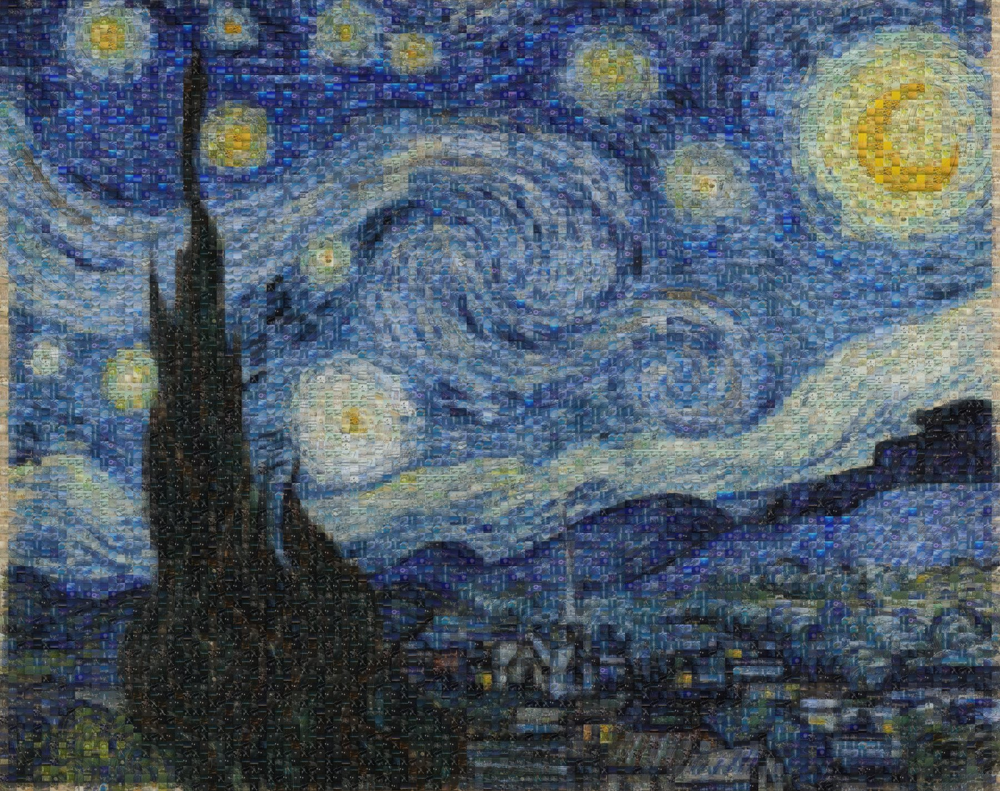
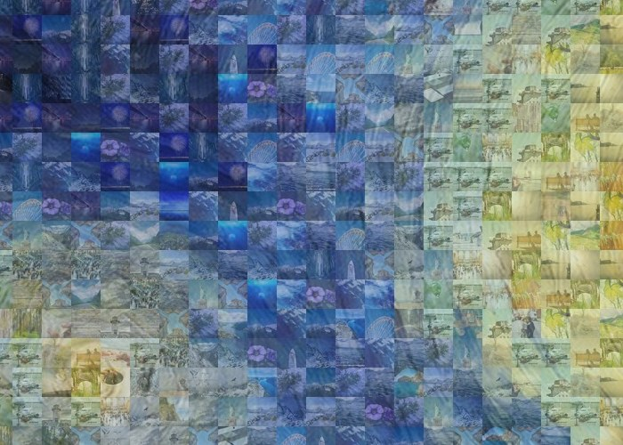
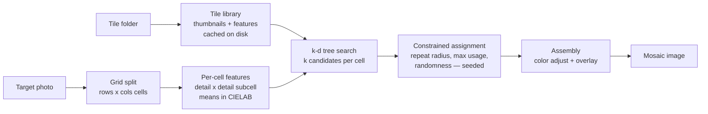

# PicMosaic

**Many of your own images in, one big picture out — color-matched automatically, with the sources, density, and resolution all under your control.**

[English](https://github.com/Yingjie-Zhu/picmosaic/blob/main/README.md) | [中文文档](https://github.com/Yingjie-Zhu/picmosaic/blob/main/README.zh-CN.md)

[](https://github.com/Yingjie-Zhu/picmosaic/actions/workflows/ci.yml)
[](https://www.python.org/downloads/)
[](https://github.com/Yingjie-Zhu/picmosaic/blob/main/LICENSE)
[](https://github.com/astral-sh/ruff)
<!-- After the first PyPI release, add:
[](https://pypi.org/project/picmosaic/)
-->

<p align="center">
  
  
</p>
<p align="center"><em>Left: Van Gogh's <strong>The Starry Night</strong> (1889, public domain). Right: the same painting rebuilt from real photos, automatically color-matched.</em></p>
<p align="center">
  
</p>
<p align="center"><em>Zoom in — every single cell is a real photograph (<a href="https://github.com/Yingjie-Zhu/picmosaic/blob/main/docs/images/CREDITS.md">image credits</a>).</em></p>

PicMosaic is a commercial-grade photomosaic engine that ships as a **zero-install browser
app** for everyone, and as a Python library with a polished CLI for developers. Point it
at a photo and a folder of images — it reads each image's colors and rebuilds the photo
cell by cell from the best matches — perceptually matched, repetition-controlled, and fast.

> **🚀 Try it right now — no install, no command line:**
> **[Open the web app](https://yingjie-zhu.github.io/picmosaic/)** (it runs entirely in your
> browser; your photos never leave your device), or double-click `docs/index.html` from a
> local copy. Hit "One-click demo" and you'll have a finished mosaic in seconds.

## Features

- **Perceptual color matching** — matching runs in CIELAB color space by default, so
  results look right to the human eye (raw RGB matching is also available).
- **Subcell detail matching** — every cell is compared on a `detail x detail` grid of
  subcell colors — not just one average — so tiles line up with the edges and gradients
  inside each cell.
- **Fast k-d tree search** — with the `fast` extra, nearest-tile lookup uses
  `scipy.spatial.cKDTree`; without SciPy it falls back to a memory-bounded vectorized
  NumPy search with identical results.
- **Repetition control** — `--repeat-radius` keeps identical tiles apart,
  `--max-usage` caps how often any one tile appears, and `--randomness` adds seeded
  variety.
- **Color adjust** — optionally blend each placed tile toward its cell's true color for a
  crisper likeness.
- **Overlay** — alpha-blend the original photo over the mosaic; at `0.2`–`0.3` it stays
  almost invisible yet dramatically improves readability.
- **Smart caching** — tile libraries are cached on disk and rebuilt automatically when
  files change, so repeat runs start instantly.
- **High-resolution output** — `--upscale` renders tiles at higher resolution than the
  analysis grid for poster-quality output, with a memory guard against absurd sizes.
- **Robust format support** — JPEG, PNG, WebP, BMP, TIFF; EXIF orientation applied;
  CMYK/palette/grayscale/alpha inputs handled; unreadable tiles are skipped, never fatal.
- **Browser app + CLI + library** — non-technical users get a zero-install web page
  (all processing stays on-device); developers get the terminal and the Python API.
- **Deterministic** — same inputs + same `--seed` = pixel-identical output, on every OS.

## Installation

Requires Python 3.10+.

```bash
pip install picmosaic          # after the first PyPI release
```

From source:

```bash
pip install "git+https://github.com/Yingjie-Zhu/picmosaic.git"
```

### Optional extras

| Extra  | Install                        | What it adds                                    |
| ------ | ------------------------------ | ----------------------------------------------- |
| `fast` | `pip install "picmosaic[fast]"` | SciPy k-d tree — much faster tile matching      |
| `dev`  | `pip install "picmosaic[dev]"`  | pytest, ruff, mypy, pre-commit (for contributors) |

Extras combine: `pip install "picmosaic[fast,dev]"`.

## Quickstart

Rebuild *The Starry Night* from free, openly licensed photos — three commands total:

```bash
git clone https://github.com/Yingjie-Zhu/picmosaic.git && cd picmosaic
python3 -m venv .venv && source .venv/bin/activate   # Windows: .venv\Scripts\activate
pip install -e ".[fast]"
python examples/fetch_demo_assets.py
picmosaic examples/target.jpg --tiles examples/tiles --tile-size 16 --upscale 2 --overlay 0.25 --color-adjust 0.45 -o demo-mosaic.jpg
```

Open `demo-mosaic.jpg` — that's your first photomosaic. (Offline? `python
examples/make_demo_assets.py` generates synthetic demo images instead — then use
`examples/target.png`.)

With your own images:

```bash
picmosaic family-photo.jpg --tiles ~/Pictures/vacation --upscale 4 --overlay 0.25
```

This writes `family-photo-mosaic.jpg` next to the target. For best results, feed it a
folder of **500+ varied images** (subfolders are searched automatically).

## CLI reference

```
usage: picmosaic TARGET --tiles DIR [options]
```

| Option                  | Default                                  | Description                                                                 |
| ----------------------- | ---------------------------------------- | --------------------------------------------------------------------------- |
| `TARGET`                | (required)                               | Target image path.                                                          |
| `-t`, `--tiles DIR`     | (required)                               | Folder with tile images (searched recursively).                             |
| `-o`, `--output PATH`   | `<target_stem>-mosaic.jpg` next to target | Output image path.                                                          |
| `--tile-size INT`       | `32`                                     | Cell size in target pixels; smaller means a finer grid with more cells.     |
| `--upscale INT`         | `1`                                      | Output resolution multiplier (each tile rendered at `tile-size * upscale`, rounded up to a multiple of `--detail`). |
| `--detail INT`          | `3`                                      | Subcell matching detail, 1–4. Higher preserves edges better.                |
| `--color-space {lab,rgb}` | `lab`                                  | Matching color space; `lab` is perceptual and recommended.                  |
| `--candidates INT`      | `12`                                     | Nearest-neighbor candidates considered per cell.                            |
| `--repeat-radius INT`   | `1`                                      | Minimum grid distance (Chebyshev) between copies of a tile; `0` disables.   |
| `--max-usage INT`       | unlimited                                | Maximum placements per tile (best-effort when the library is too small; a warning is logged). |
| `--randomness FLOAT`    | `0.0`                                    | 0–1. `0` always picks the best match; higher values sample among the candidates. |
| `--color-adjust FLOAT`  | `0.3`                                    | 0–1 blend of each placed tile toward its cell's mean color.                 |
| `--overlay FLOAT`       | `0.0`                                    | 0–1 alpha of the original photo blended over the finished mosaic.           |
| `--seed INT`            | none                                     | Random seed for fully reproducible output.                                  |
| `--workers INT`         | auto (`min(8, cpu_count)`)               | Threads used to load tile images.                                           |
| `--no-cache`            | off                                      | Disable the on-disk tile library cache.                                     |
| `--no-recursive`        | off                                      | Do not search the tile folder recursively.                                  |
| `-q`, `--quiet`         | off                                      | Warnings/errors only; hides progress bars.                                  |
| `-v`, `--verbose`       | off                                      | Debug logging and full tracebacks.                                          |
| `--version`             | —                                        | Print version and exit.                                                     |

On success the CLI prints a summary: output path and size, grid dimensions, unique tiles
used vs. library size, and elapsed time.

### Recipes

```bash
# Poster-quality print: dense grid, 6x resolution, subtle overlay
picmosaic photo.jpg -t tiles/ --tile-size 20 --upscale 6 --overlay 0.25

# Maximum variety: no tile used twice (needs more tiles than cells), near neighbors differ
picmosaic photo.jpg -t tiles/ --max-usage 1 --repeat-radius 2 --randomness 0.3

# Reproducible build for a client
picmosaic photo.jpg -t tiles/ --seed 42 -o client-proof.jpg
```

## Python API

```python
from picmosaic import MosaicConfig, build_mosaic

result = build_mosaic(
    "photo.jpg",
    "path/to/tiles",
    MosaicConfig(tile_size=24, upscale=4, overlay=0.25, seed=42),
    progress=True,
)
result.save("photo-mosaic.jpg")

print(f"grid: {result.grid}, cells: {result.total_cells}")
print(f"unique tiles: {result.unique_tiles} / {result.library_size}")
print(f"built in {result.elapsed:.1f}s")
```

### Reusing a tile library across runs

Building the library — loading and featurizing an entire image folder — is the expensive
part. Build it once and reuse it for as many targets as you like:

```python
from picmosaic import MosaicConfig, build_library, build_mosaic

config = MosaicConfig(tile_size=24, upscale=4, seed=7)
library = build_library(
    "path/to/tiles",
    render_size=config.tile_size * config.upscale,
    detail=config.detail,
    color_space=config.color_space,
    progress=True,
)

for photo in ["a.jpg", "b.jpg", "c.jpg"]:
    result = build_mosaic(photo, config=config, library=library)
    result.save(f"{photo.rsplit('.', 1)[0]}-mosaic.jpg")
```

Errors are typed: `PicMosaicError` is the base class, with `TargetImageError` for a bad
target and `TileLibraryError` for a missing or empty tile folder. Invalid configuration
raises `ValueError`.

### Browser app (no install)

`docs/index.html` is a fully self-contained web app: the entire engine, ported to
JavaScript and running 100% client-side — photos never leave the device.

- **Online**: https://yingjie-zhu.github.io/picmosaic/ — to enable, open the repository's
  *Settings → Pages* and choose *Deploy from a branch* → `main` → `/docs`.
- **Offline**: download the repo and double-click `docs/index.html`.

## How it works



1. **Grid** — the target is split into cells of `tile-size` pixels and resized so the
   grid covers it exactly — full coverage, never black edges.
2. **Features** — each cell is described by the mean color of its `detail x detail`
   subcells, converted to CIELAB so distances match human color perception. The same
   features are computed for every tile in the library (and cached).
3. **Search** — a k-d tree (or an equivalent NumPy fallback) returns the `candidates`
   nearest tiles for every cell in one batched query.
4. **Assignment** — cells are visited in a seeded random order; each takes the best
   candidate that respects `repeat-radius` and `max-usage`, with optional
   inverse-distance `randomness` sampling. Every cell always gets a tile.
5. **Assembly** — tiles are rendered row by row (which bounds peak memory), optionally
   blended toward the true cell color (`color-adjust`) and under the original photo
   (`overlay`).

## Performance tips

- **Install the `fast` extra.** SciPy's cKDTree makes matching dramatically faster on
  large libraries and dense grids.
- **Let the cache work.** The first run featurizes every tile; subsequent runs load a
  compressed cache keyed by file paths, sizes, and mtimes. Use `--no-cache` only for
  debugging. The cache lives in `~/.cache/picmosaic` (or `%LOCALAPPDATA%\picmosaic\cache`
  on Windows).
- **Reuse the library in Python** (see above) when generating many mosaics from the same
  tile set.
- **Tune `--workers`** if tile loading is the bottleneck on fast SSDs (default is
  `min(8, cpu_count)`).
- **Lower `--candidates`** for a small speedup on huge grids; raise it if the variety
  constraints keep forcing poor matches.
- Resizing uses `Image.Resampling.LANCZOS` throughout — never the removed
  `Image.ANTIALIAS` alias — so PicMosaic runs cleanly on current Pillow.

## FAQ

**Why does my mosaic look repetitive?**
The library is too small or too monochrome for the target. Add more tiles (see below)
and combine the variety controls: `--max-usage` caps repeats globally,
`--repeat-radius` spreads copies apart, and `--randomness 0.2`–`0.4` breaks up
"same tile everywhere" regions at a tiny quality cost.

**How many tile images do I need?**
At least **500 varied images** for good results, **1000+** for great ones. Color variety
matters more than count — 300 photos spanning many hues beat 2000 near-identical ones.

**The mosaic is recognizable but muddy. How do I sharpen the likeness?**
Add `--overlay 0.2`–`0.3`. A faint copy of the original blended over the mosaic goes
largely unnoticed yet dramatically improves readability — a classic photomosaic trick.
Raising `--color-adjust` (e.g. `0.5`) also pulls each tile closer to the true cell
color, and a smaller `--tile-size` gives a finer grid.

**It says the output would exceed the memory guard. What now?**
Output memory is roughly `(rows x tile_size x upscale) x (cols x tile_size x upscale) x 3`
bytes; PicMosaic refuses above 8 GiB. Lower `--upscale` (or raise `--tile-size`).

**Can I use tiles and targets with non-ASCII paths (e.g. Chinese folder names)?**
Yes. PicMosaic uses Pillow and `pathlib` exclusively, which handle Unicode paths
correctly on Windows, macOS, and Linux.

**Are results reproducible?**
Yes — pass `--seed`. The same target, tiles, and options then produce identical output.

**Why Lab instead of RGB matching?**
Equal distances in CIELAB correspond roughly to equal *perceived* color differences,
so matches look right. `--color-space rgb` exists for comparison and speed experiments.

## Roadmap

- **Palette adaptation** — recolor tiles toward the target palette for small libraries.
- **Adaptive quadtree grids** — larger cells in flat areas, finer cells around detail.
- **Video mosaics** — per-frame mosaics with temporal stabilization (no flicker).
- **Masked / shaped mosaics** — fill an arbitrary shape or logo instead of a rectangle.

Have another idea? [Open a feature request](https://github.com/Yingjie-Zhu/picmosaic/issues/new/choose).

## Project structure

```
picmosaic/
├── docs/
│   ├── index.html        # the zero-install browser app (single file, works offline)
│   └── images/           # demo images used by this README
├── src/picmosaic/        # the Python engine (library + CLI)
├── tests/                # pytest suite
├── examples/
│   ├── fetch_demo_assets.py  # downloads the quickstart demo assets (needs network)
│   └── make_demo_assets.py   # generates a demo target + synthetic tiles, fully offline
├── .github/              # CI workflows, issue templates, contributing docs
├── pyproject.toml        # packaging, dependencies, lint/type/test config
├── CHANGELOG.md · LICENSE · README.md · README.zh-CN.md
└── .gitignore · .pre-commit-config.yaml
```

## Contributing

Contributions are welcome! See [CONTRIBUTING.md](.github/CONTRIBUTING.md) for the development
setup (ruff, mypy, pytest, pre-commit) and PR guidelines. Please also read our
[Code of Conduct](.github/CODE_OF_CONDUCT.md).

## License

[MIT](LICENSE) © 2026 picmosaic contributors.
