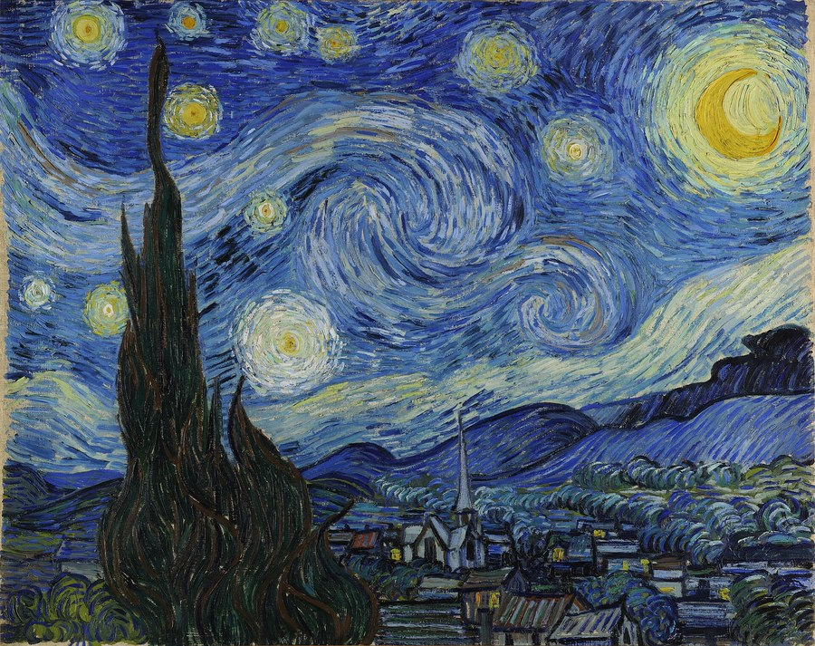
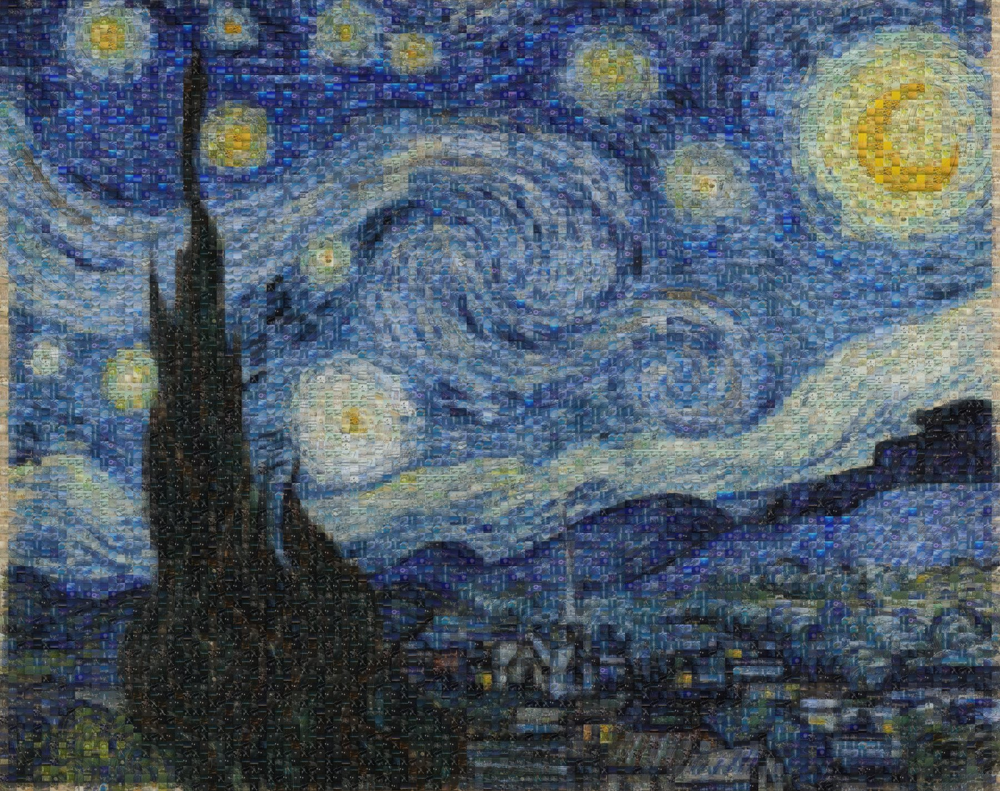
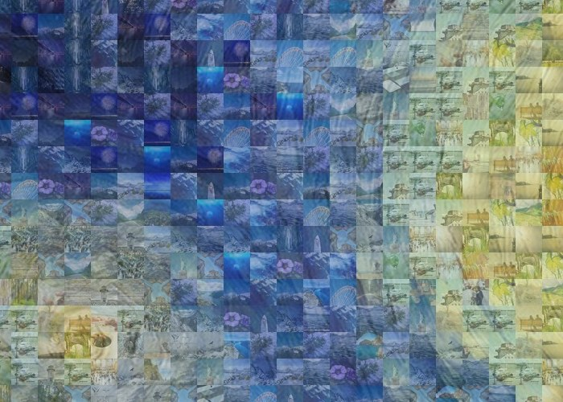
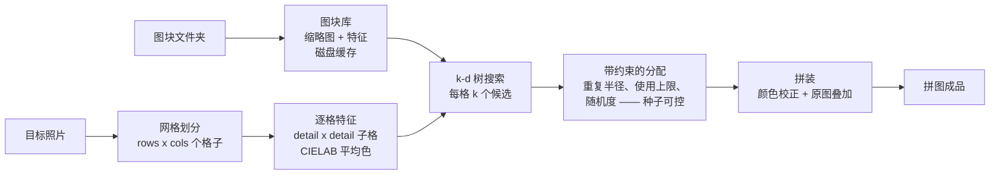

# PicMosaic

**把许许多多张你自己的图片，按颜色自动拼成一幅画 —— 素材、密度、清晰度，全由你决定。**

[English](README.md) | [中文文档](README.zh-CN.md)

[](https://github.com/Yingjie-Zhu/picmosaic/actions/workflows/ci.yml)
[](https://www.python.org/downloads/)
[](LICENSE)
[](https://github.com/astral-sh/ruff)

<p align="center">
  
  
</p>
<p align="center"><em>左：梵高《星月夜》（1889 年，公有领域）。右：同一幅画，由一张张真实照片按颜色自动拼成。</em></p>
<p align="center">
  
</p>
<p align="center"><em>放大看 —— 每一个格子都是一张真实的照片（<a href="docs/images/CREDITS.md">图片来源</a>）。</em></p>

PicMosaic 是一个商用级「千图成像」（photomosaic，又称照片马赛克）引擎：普通用户打开**零安装的网页版**
即可上手，开发者则有 Python 库和一套精致的命令行工具。给它一张照片和一个装满图片的文件夹，
它会自动读取每张图片的颜色，逐格挑出最匹配的一张铺进画面，把照片重新拼出来 ——
感知色彩匹配、重复度可控、速度飞快。

> **🚀 立即试玩 —— 无需安装、无需命令行：**
> **[打开网页版](https://yingjie-zhu.github.io/picmosaic/)**（完全在你的浏览器本地运行，
> 照片不会离开你的设备），或下载仓库后双击 `docs/index.html`。
> 点击「一键示例」，几秒钟就能看到成品。

## 特性

- **感知色彩匹配** —— 默认在 CIELAB 色彩空间中匹配图块，结果贴合人眼的真实感受
  （也支持原始 RGB 匹配）。
- **子格细节匹配** —— 每个格子按 `detail x detail` 个子格的颜色逐一比较（而不是只看
  一个平均色），图块因此能贴合格子内部的边缘与渐变。
- **k-d 树快速搜索** —— 安装 `fast` 扩展后，最近邻图块查找交给
  `scipy.spatial.cKDTree`；没有 SciPy 时自动回退到内存受控的 NumPy 向量化搜索，
  结果完全一致。
- **重复控制** —— `--repeat-radius` 让相同图块彼此远离，`--max-usage` 限制单张图块的
  使用次数，`--randomness` 加入可复现的随机变化。
- **颜色校正** —— 将每个图块向所在格子的真实颜色适度混合，让整体更贴近原图。
- **原图叠加** —— 以一定透明度把原始照片叠加在成品上；`0.2`–`0.3` 几乎看不出来，
  却能显著提升可辨识度。
- **智能缓存** —— 图块库缓存在磁盘上，文件一变即自动重建；再次运行瞬间启动。
- **高分辨率输出** —— `--upscale` 让图块以高于分析网格的分辨率渲染，轻松输出海报级
  大图，并内置内存保护，不会失控。
- **全面的格式支持** —— JPEG、PNG、WebP、BMP、TIFF；自动应用 EXIF 旋转；
  CMYK/调色板/灰度/透明通道均可处理；读不出的图块自动跳过，绝不崩溃。
- **网页版 + CLI + 库** —— 普通用户打开网页即用、零安装（所有处理都在本地设备完成）；
  开发者可在终端运行，也可在 Python 中自动化调用。
- **确定性输出** —— 相同输入 + 相同 `--seed` = 在任何操作系统上逐像素一致的结果。

## 安装

需要 Python 3.10 或更高版本。

```bash
pip install picmosaic          # 首次发布到 PyPI 之后
```

从源码安装：

```bash
pip install "git+https://github.com/Yingjie-Zhu/picmosaic.git"
```

### 可选扩展

| 扩展   | 安装命令                         | 提供的功能                                     |
| ------ | -------------------------------- | ---------------------------------------------- |
| `fast` | `pip install "picmosaic[fast]"`  | SciPy k-d 树 —— 图块匹配大幅提速               |
| `dev`  | `pip install "picmosaic[dev]"`   | pytest、ruff、mypy、pre-commit（面向贡献者）   |

扩展可以组合安装：`pip install "picmosaic[fast,dev]"`。

## 快速上手

几条命令，用免费、可自由使用的照片把梵高《星月夜》重新拼出来：

```bash
git clone https://github.com/Yingjie-Zhu/picmosaic.git && cd picmosaic
python3 -m venv .venv && source .venv/bin/activate   # Windows 系统：.venv\Scripts\activate
pip install -e ".[fast]"
python examples/fetch_demo_assets.py
picmosaic examples/target.jpg --tiles examples/tiles --tile-size 16 --upscale 2 --overlay 0.25 --color-adjust 0.45 -o demo-mosaic.jpg
```

打开 `demo-mosaic.jpg` —— 这就是你的第一幅拼图作品。（没有网络？改用
`python examples/make_demo_assets.py` 生成合成演示素材，目标图为 `examples/target.png`。）

换成你自己的图片：

```bash
picmosaic family-photo.jpg --tiles ~/Pictures/vacation --upscale 4 --overlay 0.25
```

成品会保存在目标图片旁，名为 `family-photo-mosaic.jpg`。想要最佳效果，文件夹里最好有
**500 张以上、色彩多样的图片**（子文件夹会自动搜索）。

## CLI 参考

```
usage: picmosaic TARGET --tiles DIR [options]
```

| 选项                      | 默认值                                     | 说明                                                                 |
| ------------------------- | ------------------------------------------ | -------------------------------------------------------------------- |
| `TARGET`                  | （必填）                                   | 目标图片路径。                                                       |
| `-t`, `--tiles DIR`       | （必填）                                   | 图块图片所在文件夹（递归搜索）。                                     |
| `-o`, `--output PATH`     | 目标图片旁的 `<目标文件名>-mosaic.jpg`     | 输出图片路径。                                                       |
| `--tile-size INT`         | `32`                                       | 格子在目标图中的像素大小 —— 越小格子越多、越精细。                   |
| `--upscale INT`           | `1`                                        | 输出分辨率倍数（每个图块以 `tile-size * upscale` 渲染，并向上取整为 `--detail` 的倍数）。 |
| `--detail INT`            | `3`                                        | 子格匹配的细节等级（1–4），越高越能保留边缘。                        |
| `--color-space {lab,rgb}` | `lab`                                      | 匹配所用色彩空间；`lab` 符合视觉感知，推荐使用。                     |
| `--candidates INT`        | `12`                                       | 每个格子考虑的最近邻候选图块数量。                                   |
| `--repeat-radius INT`     | `1`                                        | 相同图块之间的最小网格距离（切比雪夫距离）；`0` 表示禁用。           |
| `--max-usage INT`         | 不限                                       | 单个图块最多可被使用的次数（图库不够大时尽力满足，并输出警告）。     |
| `--randomness FLOAT`      | `0.0`                                      | 0–1。`0` 总是选择最佳匹配；数值越高越倾向在候选中随机采样。          |
| `--color-adjust FLOAT`    | `0.3`                                      | 0–1，将每个图块向其格子的平均颜色混合的比例。                        |
| `--overlay FLOAT`         | `0.0`                                      | 0–1，将原始照片叠加在成品上的透明度。                          |
| `--seed INT`              | 无                                         | 随机种子，用于完全可复现的输出。                                     |
| `--workers INT`           | 自动（`min(8, cpu_count)`）                | 加载图块图片使用的线程数。                                           |
| `--no-cache`              | 关                                         | 禁用磁盘上的图块库缓存。                                             |
| `--no-recursive`          | 关                                         | 不递归搜索图块文件夹。                                               |
| `-q`, `--quiet`           | 关                                         | 只输出警告/错误；隐藏进度条。                                        |
| `-v`, `--verbose`         | 关                                         | 调试日志与完整错误堆栈。                                             |
| `--version`               | —                                          | 打印版本号并退出。                                                   |

运行成功后，CLI 会打印一份摘要：输出路径与尺寸、网格行列数、实际用到的不同图块数 /
图块库总数，以及耗时。

### 常用配方

```bash
# 海报级打印：密集网格、6 倍分辨率、轻微叠加
picmosaic photo.jpg -t tiles/ --tile-size 20 --upscale 6 --overlay 0.25

# 大图库下追求最大多样性：每个图块只用一次（需要图库张数多于格子数），相邻格子互不相同
picmosaic photo.jpg -t tiles/ --max-usage 1 --repeat-radius 2 --randomness 0.3

# 给客户交付可复现的结果
picmosaic photo.jpg -t tiles/ --seed 42 -o client-proof.jpg
```

## Python API

```python
from picmosaic import MosaicConfig, build_mosaic

result = build_mosaic(
    "photo.jpg",
    "path/to/tiles",
    MosaicConfig(tile_size=24, upscale=4, overlay=0.25, seed=42),
    progress=True,
)
result.save("photo-mosaic.jpg")

print(f"grid: {result.grid}, cells: {result.total_cells}")
print(f"unique tiles: {result.unique_tiles} / {result.library_size}")
print(f"built in {result.elapsed:.1f}s")
```

### 跨多次运行复用图块库

构建图块库 —— 加载整个图片文件夹并提取特征 —— 是最耗时的一步。构建一次，就能反复
用于多张目标图：

```python
from picmosaic import MosaicConfig, build_library, build_mosaic

config = MosaicConfig(tile_size=24, upscale=4, seed=7)
library = build_library(
    "path/to/tiles",
    render_size=config.tile_size * config.upscale,
    detail=config.detail,
    color_space=config.color_space,
    progress=True,
)

for photo in ["a.jpg", "b.jpg", "c.jpg"]:
    result = build_mosaic(photo, config=config, library=library)
    result.save(f"{photo.rsplit('.', 1)[0]}-mosaic.jpg")
```

异常类型清晰：`PicMosaicError` 是基类；目标图片有问题时抛出 `TargetImageError`，
图块文件夹缺失或为空时抛出 `TileLibraryError`，配置参数非法则抛出 `ValueError`。

### 网页版（零安装）

`docs/index.html` 是一个完全自包含的网页应用：整个引擎已完整移植为 JavaScript，
100% 在你的浏览器本地运行（照片不会离开你的设备）。

- **在线使用**：https://yingjie-zhu.github.io/picmosaic/ ——打开即用。
- **离线使用**：下载仓库后双击 `docs/index.html`。

## 工作原理



1. **网格** —— 把目标图划分成 `tile-size` 像素见方的格子，并缩放到恰好被网格整除
   （完整覆盖，绝无黑边）。
2. **特征** —— 每个格子用 `detail x detail` 个子格的平均颜色来描述，并转换到 CIELAB
   空间，让数值距离对应人眼感知的色差。图块库中的每张图也计算同样的特征（并缓存）。
3. **搜索** —— k-d 树（或结果等价的 NumPy 回退实现）在一次批量查询中，为每个格子找出
   `candidates` 个最接近的图块。
4. **分配** —— 按种子控制的随机顺序遍历格子；每个格子在满足 `repeat-radius` 和
   `max-usage` 约束的候选中取最佳者，也可按 `randomness` 做逆距离加权的随机采样。
   每个格子最终都会分到图块。
5. **拼装** —— 逐行渲染图块以控制内存峰值，可按需向格子真实颜色混合
   （`color-adjust`），再叠加原图（`overlay`）。

## 性能建议

- **安装 `fast` 扩展。** 大图库、密集网格下，SciPy 的 cKDTree 能把匹配速度提升一个
  数量级。
- **善用缓存。** 首次运行会为每个图块计算特征；之后的运行直接加载压缩缓存
  （以文件路径、大小和修改时间为键）。`--no-cache` 仅用于调试。缓存位于
  `~/.cache/picmosaic`（Windows 上为 `%LOCALAPPDATA%\picmosaic\cache`）。
- **在 Python 中复用图块库**（见上文）—— 用同一批图块生成多幅作品时尤其划算。
- **调整 `--workers`** —— 图块加载成为瓶颈时（例如高速 SSD），可以加大线程数
  （默认 `min(8, cpu_count)`）。
- **调小 `--candidates`** 可在超大网格上略微提速；若多样性约束经常拉低匹配质量，
  就调大它。
- Pillow 缩放统一使用 `Image.Resampling.LANCZOS`（绝不使用已被移除的
  `Image.ANTIALIAS` 别名），在最新版 Pillow 上也能放心运行。

## 常见问题

**为什么我的成品看起来很重复？**
图块库太小，或颜色太单一。先增加图块数量（见下一条），再组合使用多样性控制：
`--max-usage` 从全局限制重复次数，`--repeat-radius` 让相同图块彼此远离，
`--randomness 0.2`–`0.4` 能以极小的质量代价，打散「满屏同一张图」的区域。

**我需要多少张图块图片？**
至少 **500 张色彩多样的图片**才会有好效果，**1000 张以上**效果极佳。色彩多样比数量
庞大更重要 —— 色相覆盖面广的 300 张照片，胜过 2000 张几乎一样的照片。

**成品能认出来但有点「糊」，怎样更清晰？**
加上 `--overlay 0.2`–`0.3`：在成品上叠一层淡淡的原图，几乎察觉不到，却能显著提升
可辨识度 —— 这是这类作品的经典技巧。调高 `--color-adjust`（如 `0.5`）会把每个图块
拉向格子的真实颜色；更小的 `--tile-size` 则带来更精细的网格。

**提示输出超过内存保护上限，怎么办？**
输出占用的内存约为 `(rows x tile_size x upscale) x (cols x tile_size x upscale) x 3`
字节，超过 8 GiB 时 PicMosaic 会拒绝执行。调低 `--upscale`，或调大 `--tile-size` 即可。

**可以使用含非 ASCII 字符（如中文文件夹名）的路径吗？**
可以。PicMosaic 全程使用 Pillow 和 `pathlib`，在 Windows、macOS、Linux 上都能正确处理
Unicode 路径。

**结果可以复现吗？**
可以 —— 传入 `--seed`。相同的目标、图块和参数，就会得到完全一致的输出。

**为什么用 Lab 而不是 RGB 匹配？**
CIELAB 中相等的距离，大致对应人眼*感知到的*相等色差，匹配结果因此看起来更自然。
`--color-space rgb` 保留下来，用于对比和速度实验。

## 路线图

- **调色板自适应** —— 图库较小时，让图块颜色向目标的调色板靠拢。
- **自适应四叉树网格** —— 平坦区域用大格子，细节丰富处用小格子。
- **视频拼图** —— 逐帧生成，并在时间维度上保持稳定（无闪烁）。
- **蒙版/异形拼图** —— 填充任意形状或 Logo，不再局限于矩形。

有其他想法？[提交功能请求](https://github.com/Yingjie-Zhu/picmosaic/issues/new/choose)。

## 项目结构

```
picmosaic/
├── docs/
│   ├── index.html        # 零安装网页版（单文件，可离线双击使用）
│   └── images/           # README 用到的演示图片
├── src/picmosaic/        # Python 引擎（库 + 命令行）
├── tests/                # pytest 测试套件
├── examples/
│   ├── fetch_demo_assets.py  # 下载快速上手所需的演示素材（需要网络）
│   └── make_demo_assets.py   # 生成演示目标图 + 合成图块，完全离线可用
├── .github/              # CI 工作流、issue 模板、贡献指南
├── pyproject.toml        # 打包、依赖、lint/类型/测试配置
├── CHANGELOG.md · LICENSE · README.md · README.zh-CN.md
└── .gitignore · .pre-commit-config.yaml
```

## 参与贡献

欢迎参与贡献！开发环境搭建（ruff、mypy、pytest、pre-commit）与 PR 规范见
[CONTRIBUTING.md](.github/CONTRIBUTING.md)。同时请阅读我们的
[行为准则](.github/CODE_OF_CONDUCT.md)。

## 许可证

[MIT](LICENSE) © 2026 picmosaic contributors。
